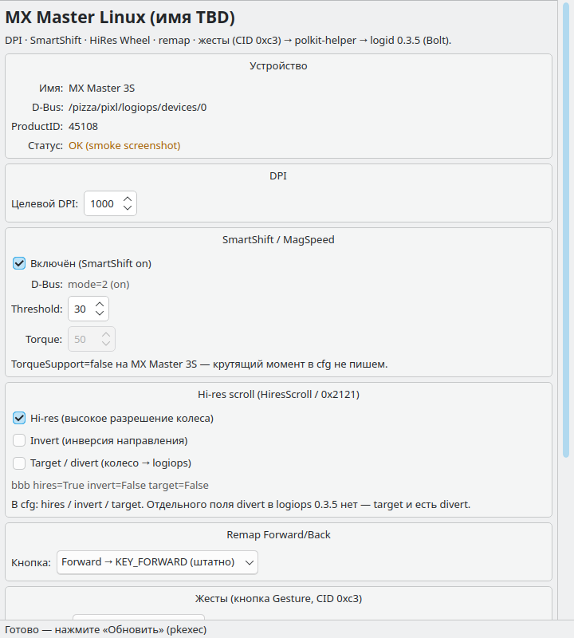

# MX Master Config (Linux)

[English](README.md) · [Русский](README.ru.md)

Linux GUI for **Logitech MX Master** mice via **[logiops](https://github.com/PixlOne/logiops)** (`logid`):
DPI, SmartShift, hi-res scroll, thumb wheel, battery status (when exposed),
button remap, and gesture button (CID `0xc3`).

| | |
|---|---|
| **License** | GPL-3.0-or-later |
| **GUI** | Qt 6 / PySide6 (fits KDE / Kubuntu) |
| **Packages** | Debian / Ubuntu family (`.deb` sketch included) |
| **Transport** | Logi Bolt (priority) + Bluetooth |
| **Requires** | **logiops ≥ 0.3** (tested on 0.3.5) |

> Display name: **MX Master Config (Linux)** · repo: `mxmaster-cfg`  
> Not an official Logitech product.



## Features

- Device status via privileged helper (`pkexec` + polkit)
- **DPI** get/set (live D-Bus + persist through cfg)
- **SmartShift** on/off + threshold (correct logiops **tri-state** `GetConfig`)
- **Hi-res scroll** (`HiresScroll` / `0x2121`): hires, invert, target/divert
- **Thumb wheel** (`ThumbWheel` / `0x2150`): divert, invert, left/right/tap presets
- **Battery** status (Unified Battery `0x1004`) when logiops exposes it over D-Bus
  (not available on packaged 0.3.5 — GUI shows n/a)
- Forward/Back **remap** and **gesture** presets (persist via `/etc/logid.cfg` + `logid` restart)
- Bolt quirk hint (“wiggle the mouse”) when devices disappear after restart
- HID++ conflict check (Solaar / OpenLogi / ratbagd)

## Quick start (Debian / Ubuntu / Kubuntu)

```bash
# 1) Dependencies (apt PySide6 preferred on Kubuntu)
sudo apt install -y \
  python3-pyside6.qtwidgets python3-pyside6.qtcore python3-pyside6.qtgui \
  logiops policykit-1

# 2) Install helper + polkit policy (asks for password once)
cd /path/to/mxmaster-cfg
bash scripts/install-helper.sh

# 3) Ensure logid is running
systemctl status logid --no-pager

# 4) Launch GUI (sets PYTHONPATH)
./run.sh
```

If you see `No module named mxmaster_cfg`, you started without `PYTHONPATH=src`.
Use `./run.sh`, or install editable: `python3 -m pip install --user -e .`

More detail: [docs/install.md](docs/install.md) · [docs/run.md](docs/run.md)

### Helper CLI smoke

```bash
pkexec /usr/local/libexec/mxmaster-cfg-helper status
pkexec /usr/local/libexec/mxmaster-cfg-helper get-dpi
pkexec /usr/local/libexec/mxmaster-cfg-helper set-dpi --dpi 1200
pkexec /usr/local/libexec/mxmaster-cfg-helper get-smartshift
pkexec /usr/local/libexec/mxmaster-cfg-helper get-hiresscroll
pkexec /usr/local/libexec/mxmaster-cfg-helper get-thumbwheel
pkexec /usr/local/libexec/mxmaster-cfg-helper get-battery
```

**Apply** in the GUI writes `/etc/logid.cfg` (backup `*.bak.mxmaster`) and restarts `logid`.
Gestures and remap go through **cfg + restart** (live `Button.SetAction` is unreliable on 0.3.5).

## Bolt / Bluetooth notes

- After `systemctl restart logid`, Bolt devices may show `device_count: 0` until you
  **move the mouse** (Easy-Switch channel on the Bolt receiver). Soft USB wake of
  `046d:c548` helps, but motion may still be required.
- Bluetooth is supported by logiops; primary smoke tests used **Logi Bolt**.
- Only one HID++ owner at a time — quit Solaar/OpenLogi while using this app.

## SmartShift tri-state (important)

logiops `SmartShift.GetConfig` returns mode **2 = on**, **1 = off**, **0 = unset** —
not “any nonzero = on”. See [docs/smartshift.md](docs/smartshift.md).

## Docs

| Topic | English | Russian |
|-------|---------|---------|
| Install helper | [docs/install.md](docs/install.md) | [docs/install.ru.md](docs/install.ru.md) |
| Run / launch | [docs/run.md](docs/run.md) | [docs/run.ru.md](docs/run.ru.md) |
| SmartShift | [docs/smartshift.md](docs/smartshift.md) | [docs/smartshift.ru.md](docs/smartshift.ru.md) |
| Hi-res scroll | [docs/hires-scroll.md](docs/hires-scroll.md) | [docs/hires-scroll.ru.md](docs/hires-scroll.ru.md) |
| Thumb wheel | [docs/thumbwheel.md](docs/thumbwheel.md) | [docs/thumbwheel.ru.md](docs/thumbwheel.ru.md) |
| Battery | [docs/battery.md](docs/battery.md) | [docs/battery.ru.md](docs/battery.ru.md) |
| Gestures | [docs/gestures.md](docs/gestures.md) | [docs/gestures.ru.md](docs/gestures.ru.md) |
| Contributing | [CONTRIBUTING.md](CONTRIBUTING.md) | [CONTRIBUTING.ru.md](CONTRIBUTING.ru.md) |

Engineering notes (mostly Russian): `docs/*-notes.md`, plan, spike, runbook.

## Layout

```
.
├── helper/mxmaster-cfg-helper   # root CLI → busctl / cfg+restart
├── polkit/org.mxmaster.cfg.policy
├── src/mxmaster_cfg/            # PySide6 GUI + adapters
├── scripts/install-helper.sh
├── run.sh
├── examples/profiles/
├── packaging/debian/            # .deb sketch
└── docs/
```

## Packaging

See [packaging/README.md](packaging/README.md). Intended Depends: `logiops (>= 0.3)`,
`policykit-1`, PySide6 packages.

## License

[GPL-3.0-or-later](LICENSE) — aligned with logiops.
