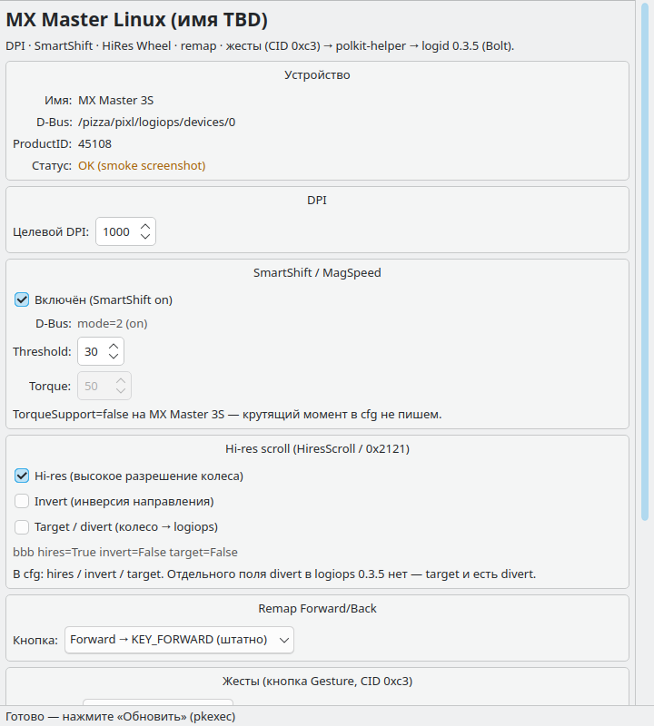

# MX Master Config (Linux)

[English](README.md) · [Русский](README.ru.md)

Linux GUI для мышей **Logitech MX Master** через **[logiops](https://github.com/PixlOne/logiops)** (`logid`):
DPI, SmartShift, hi-res scroll, thumb wheel, реальный % батареи,
remap кнопок и жесты (CID `0xc3`).

| | |
|---|---|
| **Лицензия** | GPL-3.0-or-later |
| **GUI** | Qt 6 / PySide6 (удобно для KDE / Kubuntu) |
| **Пакеты** | семейство Debian / Ubuntu (собираемый `.deb`) |
| **Транспорт** | Logi Bolt (приоритет) + Bluetooth |
| **Требования** | **logiops ≥ 0.3** (проверено на 0.3.5) |

> Отображаемое имя: **MX Master Config** · проект / пакет: `mxmaster-cfg`  
> Не официальный продукт Logitech.



## Возможности

- Статус устройства через привилегированный helper (`pkexec` + polkit)
- **DPI** чтение/запись (live D-Bus + persist через cfg)
- **SmartShift** on/off + threshold (корректный **tri-state** `GetConfig` в logiops)
- **Hi-res scroll** (`HiresScroll` / `0x2121`): hires, invert, target/divert
  (по умолчанию **hires выкл** с SmartShift → скролл по щелчку трещотки)
- **Скорость скролла**: слайдер Plasma `ScrollFactor` (безопасно, без divert);
  опционально divert Axis — [docs/scroll-speed.ru.md](docs/scroll-speed.ru.md)
- **Thumb wheel** (`ThumbWheel` / `0x2150`): divert, invert, пресеты left/right/tap
- **Батарея** % + зарядка (Unified Battery `0x1004` коротким hidraw-probe;
  UPower/sysfs, если ядро отдаёт; в D-Bus logiops 0.3.5 Battery нет)
- **Полный remap** всех remappable CID (`0x52`…`0xd7`) + **жесты** на `0xc3`
  (persist через `/etc/logid.cfg` + restart `logid`) —
  [docs/buttons.ru.md](docs/buttons.ru.md)
- **Именованные профили на диске** (YAML/JSON) в `~/.config/mxmaster-cfg/profiles/` —
  список / Сохранить как / Загрузить / На устройство / Удалить (не app-specific)
- **Ярлык в меню** — Application Menu (`.deb` или
  `scripts/install-desktop.sh` → абсолютный `./run.sh`)
- **Слайдеры** DPI / SmartShift (live D-Bus, с задержкой); опрос статуса ~15 с
- После Apply при `device_count: 0` — soft USB wake + опрос GUI; кнопка
  **Разбудить ресивер**
- Подсказка Bolt-quirk («пошевелите мышь»), если после restart устройств нет
- Проверка конфликта HID++ (Solaar / OpenLogi / ratbagd)

## Быстрый старт (Debian / Ubuntu / Kubuntu)

```bash
# 1) Зависимости
sudo apt install -y \
  python3-pyside6.qtwidgets python3-pyside6.qtcore python3-pyside6.qtgui \
  logiops policykit-1

# 2) Helper + polkit (один раз спросит пароль)
cd /path/to/mxmaster-cfg
bash scripts/install-helper.sh

# 3) logid должен быть запущен
systemctl status logid --no-pager

# 4) GUI (выставляет PYTHONPATH)
./run.sh

# 5) Опционально: меню приложений → «MX Master Config»
bash scripts/install-desktop.sh
```

Ошибка `No module named mxmaster_cfg` — запуск без `PYTHONPATH=src`.
Используйте `./run.sh` или editable: `python3 -m pip install --user -e .`

Подробнее: [docs/install.ru.md](docs/install.ru.md) · [docs/run.ru.md](docs/run.ru.md) ·
[docs/desktop.ru.md](docs/desktop.ru.md)

### Smoke helper CLI

```bash
pkexec /usr/libexec/mxmaster-cfg-helper status
pkexec /usr/libexec/mxmaster-cfg-helper get-dpi
pkexec /usr/libexec/mxmaster-cfg-helper set-dpi --dpi 1200
pkexec /usr/libexec/mxmaster-cfg-helper get-smartshift
pkexec /usr/libexec/mxmaster-cfg-helper get-hiresscroll
pkexec /usr/libexec/mxmaster-cfg-helper get-thumbwheel
pkexec /usr/libexec/mxmaster-cfg-helper get-battery
pkexec /usr/libexec/mxmaster-cfg-helper wake-receiver
```

**Применить** в GUI пишет `/etc/logid.cfg` (бэкап `*.bak.mxmaster`) и
перезапускает `logid`. Жесты и remap идут **только** через cfg+restart
(live `Button.SetAction` на 0.3.5 ненадёжен).
См. [docs/reconnect.ru.md](docs/reconnect.ru.md) про опрос / wake после Apply.

## Bolt / Bluetooth

- После `systemctl restart logid` на Bolt часто `device_count: 0`, пока не
  **пошевелите мышь** (канал Easy-Switch). Soft USB wake `046d:c548` помогает,
  но движение мыши всё равно может быть нужно. GUI опрашивает и даёт кнопку
  **Разбудить ресивер**.
- Bluetooth поддерживается logiops; основной smoke — **Logi Bolt**.
- Один owner HID++: не держите Solaar/OpenLogi параллельно.

## SmartShift tri-state (важно)

`SmartShift.GetConfig` в logiops: mode **2 = on**, **1 = off**, **0 = unset** —
не «любой nonzero = on». См. [docs/smartshift.ru.md](docs/smartshift.ru.md).

## Документация

| Тема | English | Русский |
|------|---------|---------|
| Установка helper | [docs/install.md](docs/install.md) | [docs/install.ru.md](docs/install.ru.md) |
| Запуск | [docs/run.md](docs/run.md) | [docs/run.ru.md](docs/run.ru.md) |
| Ярлык в меню | [docs/desktop.md](docs/desktop.md) | [docs/desktop.ru.md](docs/desktop.ru.md) |
| Переподключение / wake | [docs/reconnect.md](docs/reconnect.md) | [docs/reconnect.ru.md](docs/reconnect.ru.md) |
| SmartShift | [docs/smartshift.md](docs/smartshift.md) | [docs/smartshift.ru.md](docs/smartshift.ru.md) |
| Hi-res scroll | [docs/hires-scroll.md](docs/hires-scroll.md) | [docs/hires-scroll.ru.md](docs/hires-scroll.ru.md) |
| Скорость скролла | [docs/scroll-speed.md](docs/scroll-speed.md) | [docs/scroll-speed.ru.md](docs/scroll-speed.ru.md) |
| Разрыв функций | [docs/feature-gap.md](docs/feature-gap.md) | [docs/feature-gap.ru.md](docs/feature-gap.ru.md) |
| Thumb wheel | [docs/thumbwheel.md](docs/thumbwheel.md) | [docs/thumbwheel.ru.md](docs/thumbwheel.ru.md) |
| Батарея | [docs/battery.md](docs/battery.md) | [docs/battery.ru.md](docs/battery.ru.md) |
| Remap кнопок | [docs/buttons.md](docs/buttons.md) | [docs/buttons.ru.md](docs/buttons.ru.md) |
| Жесты | [docs/gestures.md](docs/gestures.md) | [docs/gestures.ru.md](docs/gestures.ru.md) |
| Contributing | [CONTRIBUTING.md](CONTRIBUTING.md) | [CONTRIBUTING.ru.md](CONTRIBUTING.ru.md) |

Инженерные заметки: `docs/*-notes.md`, план, spike, runbook.

## Структура

```
.
├── helper/mxmaster-cfg-helper
├── polkit/org.mxmaster.cfg.policy
├── src/mxmaster_cfg/
├── scripts/install-helper.sh
├── scripts/install-desktop.sh   # меню приложений → ./run.sh
├── run.sh
├── examples/profiles/
├── packaging/debian/            # собираемый .deb (debian → packaging/debian)
├── packaging/icons/             # mxmaster-cfg.svg
└── docs/
```

Профили пользователя: `~/.config/mxmaster-cfg/profiles/*.yaml` (или `.json`).
В GUI можно сохранить текущие настройки, загрузить их позже и применить
выбранный профиль на устройство.

## Упаковка (`.deb`)

См. [packaging/README.md](packaging/README.md). Зависимости: `logiops (>= 0.3)`,
`policykit-1`, пакеты PySide6, `python3-yaml`, `python3-jsonschema`.

```bash
sudo apt install -y debhelper dh-python pybuild-plugin-pyproject \
  python3-setuptools python3-all python3-yaml python3-jsonschema \
  python3-pyside6.qtwidgets dpkg-dev
./packaging/build-deb.sh
sudo apt install ../mxmaster-cfg_*.deb
```

## Лицензия

[GPL-3.0-or-later](LICENSE) — в линии с logiops.
